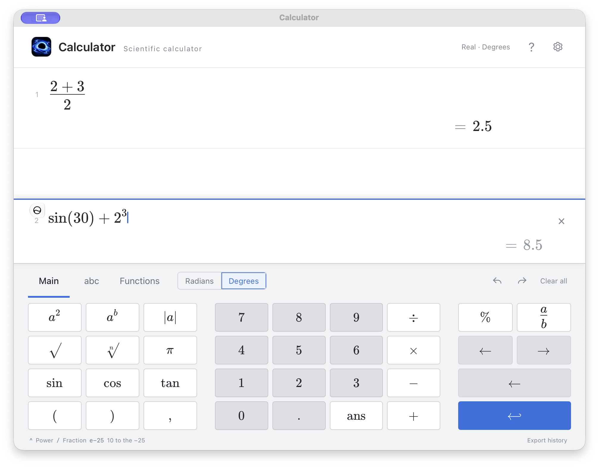
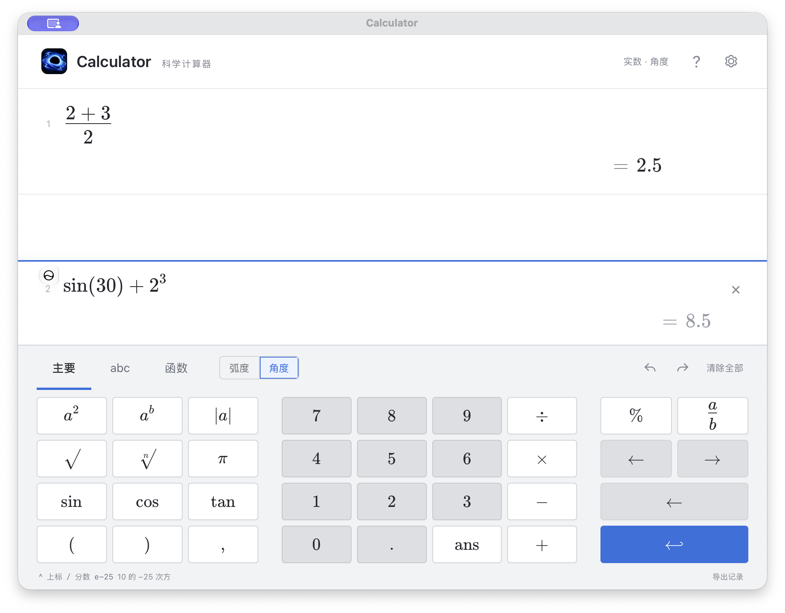

<h1 align="center">Calculator</h1>

<strong>A native macOS scientific and physics calculator that keeps your original expression editable.</strong>

Editable expressions, physical units, and a searchable formula library in one local worksheet.

  <a href="https://github.com/B0yangWong/Calculator-Releases/releases/latest">Download</a> |
  <a href="#features">Features</a> |
  <a href="PRIVACY.md">Privacy</a> |
  <a href="README.zh-CN.md">中文说明</a>

---

Type `^` to build a power, `/` to build a stacked fraction, or `1.6e-25` for scientific notation. Keep working in the same expression, see a live result, and press Enter to save it. Earlier rows remain editable, so changing a variable or calculation updates the results that follow.

This repository contains downloads, documentation, and demo images. Application source is not published here. Calculator is an independent app, not a Desmos product, and does not embed its website or proprietary code.

**v1.1.0 / build 10:** Apple Silicon Macs, macOS 14 or later. Tested on macOS 27, not on a physical macOS 14 device. No Intel build. The app is ad-hoc signed, without Developer ID signing or Apple notarization; macOS may block the first launch. See [Install and Open](#install-and-open) before proceeding.

## Features

| Feature | What you can do |
| --- | --- |
| Editable mathematical input | Type powers, roots, and fractions directly; return from an exponent or denominator to continue the original expression. |
| Scientific notation and natural e | Use `e-25` for $10^{-25}$, `1.6e-25` for $1.6\times10^{-25}$, and `10*e*3` for Euler's constant $e$. |
| Scientific functions | Arithmetic, absolute values, percentages, factorials, $\pi$, `ans`, trigonometric and hyperbolic functions and their inverses, logarithms, combinations, permutations, rounding, gcd, lcm, and modulo. |
| Variables and functions | Define $a=5$ or a single-parameter function such as $f(x)=x^2+1$, then reuse it in later rows. |
| Lists and statistics | Use element-wise operations, mean, median, sum, standard deviation, variance, and related functions. |
| Complex numbers and matrices | Enable complex-number mode when needed and use common matrix operations. |
| A reusable worksheet | Edit earlier rows, recalculate dependent results, undo and redo, copy and paste, or export history. |
| A quieter, resizable workspace | The scientific keyboard opens only when needed. A compact mode selector and settings button leave more room for expressions; smaller windows adapt the keyboard and variable panel. |
| Physics equations and units | Enter an equation, assign known values and units, and solve a supported real-scalar equation with one unknown. Compatible units convert automatically, and dimensions are checked. |
| Editable physical constants | Recognize constants such as $c$, $h$, and $\alpha$, while keeping their values and units editable. Uppercase $E$ remains a separate variable from lowercase $e$. |
| 100 physics formulas | Search in English or Chinese, browse four categories, copy a formula, or add it as a new calculation without replacing the current draft. |
| English and Chinese | Change interface and menu language, theme, and text size in Settings. Preferences and unfinished input survive a normal relaunch. |
| Offline operation | No account, telemetry upload, cloud sync, or automatic update check. |

## Preview

These screenshots show the actual **v1.0.0** app with isolated example calculations, not personal history. They are retained as input examples, not as a preview of the current layout. In v1.1.0 the large header is removed, the keyboard is collapsible, and Physics mode adds a variable panel and formula library.

Chinese interface

## Type Expressions Directly

| Input | Meaning |
| --- | --- |
| `2^3` | Editable exponent: $2^3=8$ |
| `(2+3)/2` | Editable stacked fraction: $\frac{2+3}{2}=2.5$ |
| `e-25` | $10^{-25}$ |
| `1.6e-25` | $1.6\times10^{-25}$ |
| `10*e*3` | Euler's constant: $10\times e\times3\approx81.5484548537714$ |
| `(e)-25` | $e-25$, with $e$ as Euler's constant |

A pale result is the live preview before Enter; saved results appear darker. After entering an exponent or denominator, use the right arrow to continue the main expression. Space also exits an exponent. Operators after a scientific-notation exponent return to the main expression automatically.

The default angle mode is degrees. Check the angle selector in the expanded keyboard before using trigonometric functions. Percent means division by 100, not the context-dependent percentage behavior of some commercial calculators.

## Physics Equations and Units

Choose **Physics** at the top of the window, or press `Command + 2`. Enter $E=mc^2$; the variable panel lists $E$, $m$, and $c$. The default $c$ is the speed of light in vacuum, but you can change it. Uppercase $E$ is preserved and does not become Euler's constant $e$.

Fill known values and their units; leave the value of the quantity you want to solve empty. With $m=1\,\mathrm{g}$ and the default $c$, the result is approximately $E=8.987551787\times10^{13}\,\mathrm{J}$. You can request a compatible result unit such as `eV`, or reverse the supported equation by supplying energy and leaving mass empty. The unit field also accepts `ev` as an alias for `eV`.

- Units belong in the variable or result-unit fields, not as letters mixed into the equation. Known quantities need a unit; enter `1` for a dimensionless quantity. An unknown's unit may be inferred or set to a compatible output unit.
- Composite units such as `J*s`, `kg*m/s^2`, and `s^(-1)` represent $\mathrm{J\,s}$, $\mathrm{kg\,m\,s^{-2}}$, and $\mathrm{s^{-1}}$. Unit symbols are case-sensitive. `F` means farad in a unit field; a force variable $F$ normally uses `N`.
- Constants include Planck's constant $h$, the fine-structure constant $\alpha$, and Boltzmann's constant $k_B$. Plain $k$ remains a user variable; electric charge uses $q_e$, not the mathematical constant $e$.
- Variable definitions are shared across the Physics workspace. Changing a value or unit recalculates physics history, not scientific history. Check the meaning of an existing name before reusing it. Use explicit multiplication when adjacent letters could match a built-in alias.
- With one unknown, supported real-scalar equations are solved automatically. Multiple unknowns need more supplied values. If multiple real roots are found, they are shown without choosing a physically valid one for you; if all values are supplied, the equation is checked for consistency.

Dimension checks catch incompatible additions and conversions, but do not prove a physical formula is correct. This is not a general symbolic equation solver. Arbitrary nonlinear equations, simultaneous equations, uncertainty propagation, vectors, operators, and calculus are not supported. Temperature units currently accept kelvin `K`, not offset conversions from Celsius or Fahrenheit.

## Physics Formula Library

In Physics mode, choose **Formulas**, or press `Command + Shift + F`. The library works offline and contains 100 selected university-level formulas:

| Category | Count |
| --- | ---: |
| Classical mechanics | 28 |
| Analytical mechanics | 22 |
| Quantum mechanics | 24 |
| Thermodynamics | 26 |

Search names, variables, Greek letters, or formula fragments in English or Chinese. Hover over a card, or focus it with the keyboard, to reveal **Copy** and **Add to calculation**. Actions also remain accessible in narrow windows. Each entry includes variable meanings, recommended units, applicability notes, and textbook or course sources. Source links open in an external browser only when you click them.

**Add to calculation** creates a new row and preserves the unfinished draft. It keeps existing variable values, units, and constant overrides; new ordinary variables may receive recommended units but no invented values. Review shared variables before substituting them into a new formula. Copy places a directly inputtable text equation on the clipboard for scalar entries, or LaTeX for reference entries.

The collection has **77 scalar relations and 23 reference formulas**. Scalar entries support substitution within the current single-unknown solver's limits; this does not promise that every variable in every formula can be solved for. Reference entries preserve derivatives, integrals, vector or operator relations, and inequalities; they can be viewed, copied, and saved, but are not calculated automatically. Physical constraints, allowed quantum numbers, and the choice among multiple roots remain your responsibility. This is a selection of common formulas, not a complete textbook; the rest-energy relation in the quantum category is explicitly marked as a relativity supplement.

Formula notes are independently written and checked against [OpenStax University Physics](https://openstax.org/subjects/science) and [MIT OpenCourseWare](https://ocw.mit.edu/). Constants follow [NIST / CODATA](https://physics.nist.gov/cuu/Constants/index.html); unit conventions follow the [BIPM SI Brochure](https://www.bipm.org/en/si-brochure-9).

## Install and Open

1. Download [Calculator-1.1.0-macOS-arm64.zip](https://github.com/B0yangWong/Calculator-Releases/releases/download/v1.1.0/Calculator-1.1.0-macOS-arm64.zip) from the [v1.1.0 release](https://github.com/B0yangWong/Calculator-Releases/releases/tag/v1.1.0), or find a newer build in [Latest Release](https://github.com/B0yangWong/Calculator-Releases/releases/latest).
2. Extract the archive and move `Calculator.app` into Applications. Quit an older copy normally before replacing it. No Xcode, account, or additional runtime is required.
3. Open the app. If macOS blocks it, only proceed if you trust the download and are confident it has not been altered. After the first attempt, use System Settings → Privacy & Security → Open Anyway and confirm, following [Apple's instructions](https://support.apple.com/en-us/102445). This option may not be available on a managed Mac. If macOS says the app is damaged or will harm your computer, stop and report it. Do not disable system security checks.
4. Open Settings with `Command + ,` to choose 中文 or English, a theme, and text size. Check the angle mode before calculating.

The release includes `SHA256SUMS.txt`. Compare its value with the downloaded ZIP to check for download corruption. A matching checksum does not verify publisher identity, prove the app is safe, or indicate Apple approval.

GitHub's `Source code (zip)` and `Source code (tar.gz)` contain this repository's public documentation, demo images, and notices. They are not app installers and do not contain the Calculator application source.

## Everyday Controls

| Action | Shortcut or interaction |
| --- | --- |
| Save the current calculation | `Enter` |
| Leave an exponent or denominator | Right arrow; Space also exits an exponent |
| Focus the input row | `Command + N` |
| Undo / redo | `Command + Z` / `Command + Shift + Z` |
| Copy / paste | `Command + C` / `Command + V` |
| Export history | `Command + Shift + E` |
| Clear history and unfinished input | `Command + Shift + Delete`, or Clear All; can be undone during the current session |
| Open Settings | `Command + ,` or the settings button |
| Show / hide the scientific keyboard | `Command + K` or the keyboard button |
| Scientific / Physics mode | `Command + 1` / `Command + 2` or the mode selector |
| Open the physics formula library | `Command + Shift + F` or Formulas in Physics mode |
| Open the input guide | `Command + /` or Help in the app menu |

The app saves history and unfinished input locally. Normal operation uses a single-instance guard to prevent separate app processes from writing to the same history. Force quitting or losing power is not equivalent to a normal quit.

## Privacy and Limits

History, drafts, settings, mode choice, physics variable values and units, and formula-library associations stay locally in `~/Library/Application Support/FormulaDesk/state.json`; the retained directory name does not affect the app's display name. These records are not encrypted by the app. Copy, paste, and export are user-triggered. Formula-source links are optional external browsing; calculation and library search do not require a network connection. macOS backups and diagnostic services are separate. See [Privacy](PRIVACY.md) for details, including deletion.

- General calculations use floating-point arithmetic and display 15 significant digits. This is not an arbitrary-precision calculator. Purely numeric rational expressions have an exact-fraction path; fraction / decimal result switching is limited to those expressions.
- History: up to 250 rows. Lists: up to 1024 items. Factorials: up to 170. Matrices: up to 32 × 32.
- List ranges, list indexing, multi-parameter custom functions, and recursive functions are not implemented.
- Graphing, derivatives, and integration are not available yet. Full behavioral parity with Desmos is not promised.
- Physics mode handles supported real-scalar, single-unknown equations, not arbitrary or simultaneous equations. A dimension check is not a proof of physical validity. Formula-library reference entries are not automatically solved; shared variables and physical constraints must be checked by the user.
- Tests cannot cover every expression or every supported Mac. Older supported macOS versions and a clean-Mac first launch still need hands-on validation. Independently check important calculations, including units, angle mode, and precision.

Updates are manual: download a newer version, quit normally, and replace the app without deleting its Application Support folder. See [Changelog](CHANGELOG.md) for version changes.

For [bug reports](https://github.com/B0yangWong/Calculator-Releases/issues/new/choose), include the expression, actual and expected results, angle mode, app version, and macOS version. [Feature requests](https://github.com/B0yangWong/Calculator-Releases/issues) are also welcome. Reports are public; do not upload private history or sensitive screenshots.

## Credits

MathLive provides formula editing; mathjs and its dependencies support evaluation. Third-party notices and licenses accompany the download and are also available in [Third-Party Notices](THIRD_PARTY_NOTICES.txt) and [ThirdPartyLicenses](ThirdPartyLicenses/). This download repository does not grant an open-source license to the Calculator application or icon artwork.
